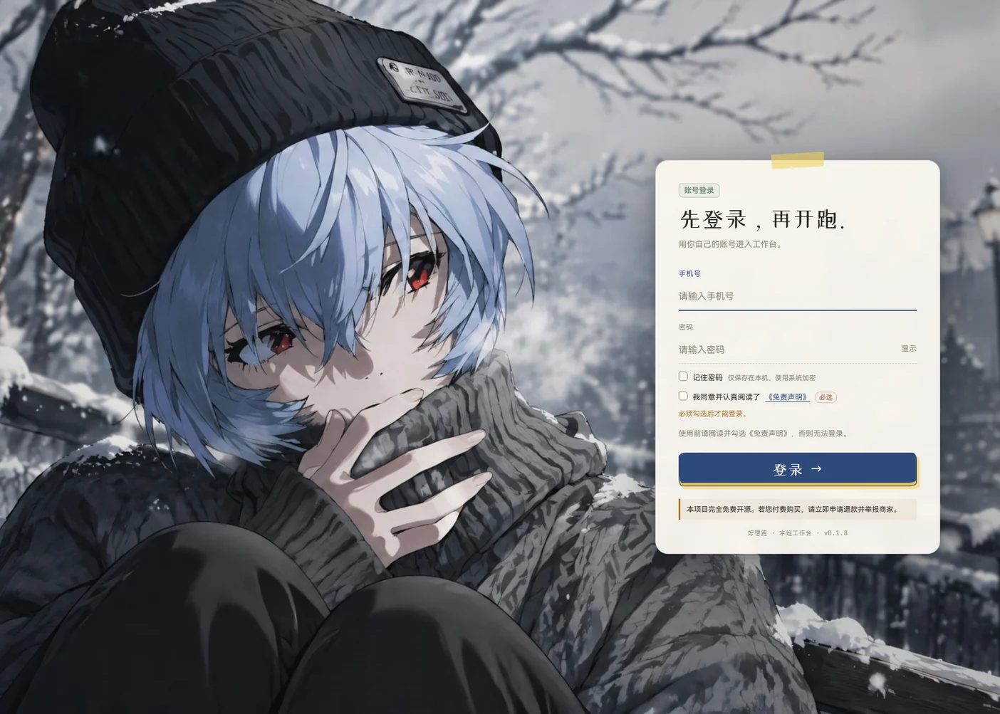

<p align="center">
  <picture>
    <source media="(prefers-color-scheme: dark)" srcset="assets/logo-light.png">
    
  </picture>
</p>

<h1 align="center">好想跑</h1>

<p align="center">
  <a href="https://github.com/Knight-ask-art/KnightSportsWorldTool/releases/latest"></a>
  <a href="https://github.com/Knight-ask-art/KnightSportsWorldTool/releases"></a>
  
  
  
</p>

<p align="center">
  <b>帮助自己分析跑步数据的平台</b><br>
</p>

<p align="center">
  <sub>本地分析 · 本地校验 · 数据留在本机</sub>
</p>

<p align="center">
  <a href="https://github.com/Knight-ask-art/KnightSportsWorldTool/releases/download/v0.2.5/haoxiangpao_v0.2.5_win64_setup.exe"></a>
  <a href="https://github.com/Knight-ask-art/KnightSportsWorldTool/releases/download/v0.2.5/haoxiangpao_v0.2.5_win64.zip"></a>
  <a href="https://github.com/Knight-ask-art/KnightSportsWorldTool/releases"></a>
</p>

<p align="center">
  <sub>安装版约 50 MB · 便携版约 69 MB · 只支持 Windows 10 / 11 64 位</sub>
</p>

> [!IMPORTANT]
> **完全免费，禁止倒卖。** 本项目没有付费版、付费安装、付费技术支持。若你是付费购买的，请立即申请退款并举报商家。
>
> **只登自己的号。** 仅用于本人账号与已授权环境，不要处理他人账号或未授权数据。

---

## 这是什么

一个给自己用的跑步数据分析工作台。

它在本地分析跑步轨迹，不经过第三方服务器。

| 项目 | 当前状态 |
|---|---|
| 版本 | **v0.2.5** · stable · 2026-11-19 |
| 回滚版本 | 无（需要时可手动装回 v0.2.4） |
| 系统 | Windows 10 / 11 · 64 位 |
| 网络 | 本机 `127.0.0.1` 工作台 |
| 价格 | 完全免费 · 禁止倒卖 |


## 界面

<p align="center">
  
</p>

<p align="center">
  <sub>登录前免责声明确认、免费 / 防倒卖提示</sub>
</p>

---

## 下载

### 安装版（推荐）

下载 `haoxiangpao_v0.2.5_win64_setup.exe`，双击安装。升级和卸载都**不会动 `data/`**。

### 便携版

下载 `haoxiangpao_v0.2.5_win64.zip`，解压后双击 `好想跑.exe`。

> [!WARNING]
> 便携版要整个文件夹一起用。`好想跑.exe` 旁边的依赖文件不要删，也别只把 exe 拖出来。

### GitHub 打不开？

在完整链接前面加镜像前缀（前两个实测可用，第三个时好时坏）：

| 前缀 | 状态 |
|---|---|
| `https://gh-proxy.com/` | 实测可用 |
| `https://ghfast.top/` | 实测可用 |
| `https://gh.llkk.cc/` | 时好时坏 |

例如安装版：

```text
https://gh-proxy.com/https://github.com/Knight-ask-art/KnightSportsWorldTool/releases/download/v0.2.5/haoxiangpao_v0.2.5_win64_setup.exe
```

---

## 第一次打开

1. 启动后先显示登录页；输入自己的手机号和密码。
2. 阅读并勾选「我同意并认真阅读了《免责声明》」，不勾选不能登录。
3. 登录成功后进入工作台，先走一遍 5 步新手引导；之后可以在「设置 → 关于 → 新手引导」重新打开。
4. `data/` 会自动出现，里面是登录状态、回执、限额、设备信息和点位缓存。想彻底重置就整个删掉，下次重新登录。

> [!NOTE]
> 从 v0.2.4 升级到 v0.2.5 不会强制退出登录，也不会删除 `data/`、回执、限额或点位缓存；直接覆盖安装即可，无需迁移数据。

---

## 更新与回滚

程序启动后会自动检查更新。0.2.3 起由启动器在后台完成：下载、校验，下次启动自动替换；应用内只显示状态。

- **安装版**：后台下载新的安装包，下次启动静默安装并替换。
- **便携版**：后台下载新 zip，下次启动自动解压替换。

两种方式都不会覆盖 `data/`。下载后会校验文件完整性，只接受 HTTPS 资产。

| 场景 | 做法 |
|---|---|
| 手动升级 | 下载新安装包 / zip，覆盖旧目录，`data/` 留着别删 |
| 回滚到 v0.2.3 | 本版不设自动回滚；需要时手动下载 v0.2.3 资产覆盖。设备指纹和 `data/` 兼容，登录状态保留 |
| 完整性 | 安装包和 zip 都会校验；校验不过会自动换镜像 |
| 更新清单 | 程序自动读取，普通使用不用管 |

完整版本历史与发布说明：[Releases](https://github.com/Knight-ask-art/KnightSportsWorldTool/releases)。

---

## 三条边界

> [!CAUTION]
> 下面三条不是“建议”，是工具的工作方式。

| 边界 | 具体做法 |
|---|---|
| **不重试提交** | 网络超时 = 未知状态。提交前会记录并锁住该时段，宁可少跑一次，也不重复入库 |
| **本地闸门** | 默认每天最多 2 次，23:00–06:00 拒绝提交；高级用法可以在命令行调整 |
| **凭据只在本机** | 登录状态和密码都用 Windows 系统加密；密码默认不落盘；`data/` 不进安装包 |

### 适合 / 不适合

| ✅ 适合 | ⛔ 不适合 |
|---|---|
| 只登自己的账号 | 登别人的账号、批量代跑 |
| 想看清楚每次分析的数据 | 商业倒卖、付费安装、二次售卖 |
| 已授权环境下的学习 / 研究 | 未授权测试、破坏服务器 |

---

## 常见问题

<details>
<summary><b>提示 10121 怎么办？</b></summary>

账号还在手机端登录着。先去手机 App 退出，再回来登。
</details>

<details>
<summary><b>Windows 提示“未知发布者”</b></summary>

没有购买代码签名证书，正常现象。点「更多信息」→「仍要运行」。
</details>

<details>
<summary><b>双击后打不开 / 一闪就没</b></summary>

大概率是解压不完整，或者 exe 和旁边的 DLL / 文件夹分家了。重新解压一遍，确保整个文件夹完整。
</details>

<details>
<summary><b>点位提示冷却中</b></summary>

点位拉取太频繁会触发限制。冷却按账号隔离，一个账号被限流不会锁住另一个账号；倒计时结束后点一次「刷新」。冷却期间会继续使用上次点位，并在界面上标注来源距离。
</details>

<details>
<summary><b>升级到 0.2.5：提交体对齐</b></summary>

- 提交体按 7.4.0 对齐：45 键、五点位 11 键（`lon`，无 `radius`），轨迹和 10 秒窗只走 OBS。
- 围栏补 `distance`；自由跑 `selRunTime=0`，学分跑取学校 `minRunTime`，`uid` 按整数发送。
- 7.3.92 兼容档位与 7.4.0 共用同一份提交体，只差请求头。
- 补充 7.4.01 静态逆向资料：实体形状与 7.4.0 一致，新增 `isValidPoint` 等客户端反作弊结论。
- 提交体的具体表现仍需要看官方；不同学校、账号可能有差异。
</details>

<details>
<summary><b>升级到 0.2.4：稳定性与 OBS 补传</b></summary>

- 安装/升级被取消、断电或失败时，`data/`（登录、回执、设备指纹）始终保留；上次中断的安装会先清理半成品再继续。
- 更新助手被安全软件拦截、没能启动时，启动器会回退启动当前版本并记录原因，不再“双击没反应”。
- 首屏停留超过 55 秒会自动进入登录页，不再白屏；离开跑步页或切到后台会关闭摄像头。
- 提交前会把 OBS 载荷快照写入 `data/obs_pending/`；服务器已受理但进程在落盘前被杀时，记录详情仍可「补传轨迹」。快照最迟 7 天清理。
- 路线学习 0 条可用轨迹时不再覆盖已有学习路线；记录页刷新失败会保留已有列表。
- 安装包体积进一步减小（移除 OpenCV），登录滑块改走本地 C++ 模块。
- 跑步页与 Agent 不再使用闭合路线和圈数；0.2.3 保存的闭环路线升级后也按开放折线加载。
</details>

<details>
<summary><b>学校没有围栏 / 没有打卡点</b></summary>

没有围栏时，可以把地图拖到学校，点「设为校区」再刷新；没有打卡点时必须显式勾选「跳过打卡点（无点位学校，非官方自由跑）」。工具不会把空点位伪装成成功。
</details>

<details>
<summary><b>“自动”路线能不能用？</b></summary>

能用，但仍在打磨。0.2.4 起跑步页只保留手绘和导入；学习路线统一在 Agent 页面规划。生成出来的路线提交前也要自己看一眼。
</details>

<details>
<summary><b>会不会上传我的数据？</b></summary>

工作台只监听 `127.0.0.1`，不经过第三方服务器。提交时只向运动世界校园官方服务发送这次跑步需要的数据；不读取相册。服务端要求人脸校验时才会调用本机摄像头，照片直接上传到学校的人脸校验接口，不在本机保存。
</details>

---

## 关于

- 只支持 Windows 10 / 11 64 位；安装版和便携版都不会覆盖 `data/`。
- 只登自己的账号；不提供批量、代跑或人脸绕过。
- 发布页只放安装包、更新清单和这份说明。

> [!NOTE]
> 源码、内部研究资料和采集样本不随安装包分发。

---

## 说明

- **人脸校验只在服务端要求时进行**：type 1（起跑前）和 type 3（终点）会调用本机摄像头，把照片上传到学校的人脸校验接口；照片不落盘，本机只保存通过状态。跑步中抽检（type=2）不实现，检测到会停止提交。
- 个人自用，不保证长期可用；
- 用不了可以提 [Issue](https://github.com/Knight-ask-art/KnightSportsWorldTool/issues)，我看到会看情况修。

---

## 免责声明

> 本软件仅供个人学习、技术研究及交流使用。请仅用于本人账号与已授权环境，不要处理他人账号或未授权数据。
>
> 软件按“现状”提供，不提供任何明示或暗示的担保；因使用不当、违规操作或恶意滥用产生的一切后果，由使用者自行承担。完整条款以软件内《软件使用协议与免责声明》为准。

<p align="center">
  <b>本项目完全免费。若您付费购买，请立即申请退款并举报商家。</b>
</p>

<p align="center">
  <a href="https://github.com/Knight-ask-art/KnightSportsWorldTool"></a>
</p>

<p align="center">
  <sub>如果它帮到了你，点个 Star 支持一下 ⭐</sub>
</p>
