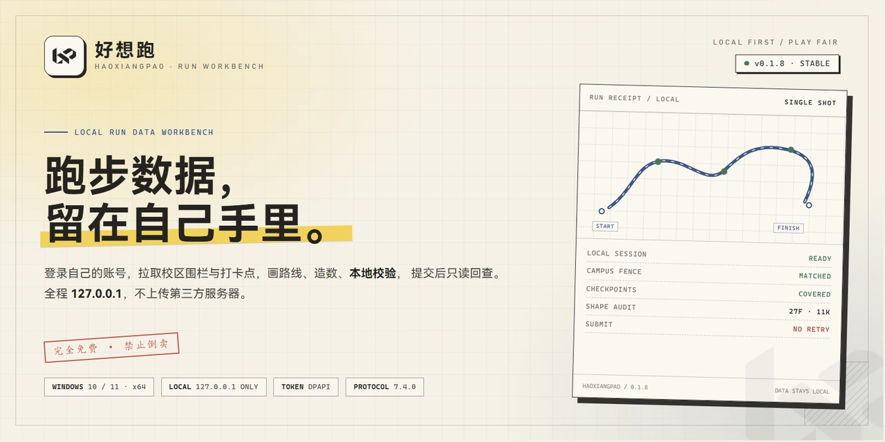
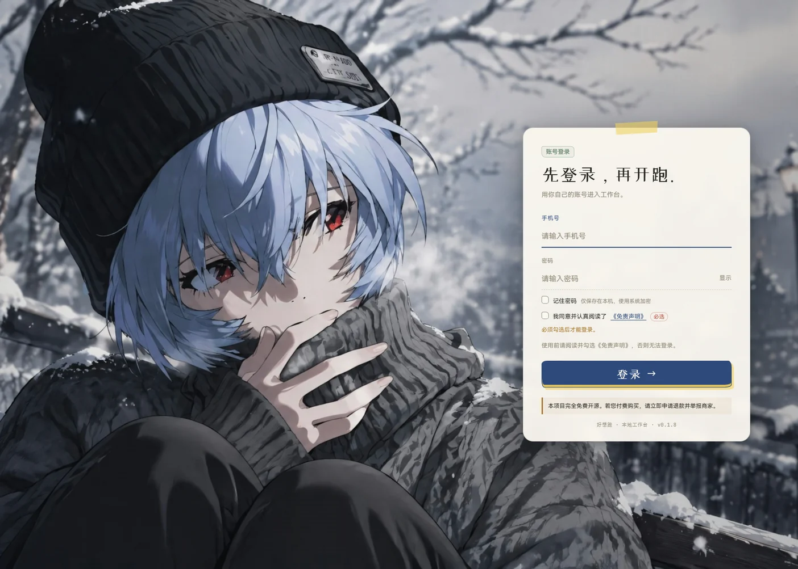
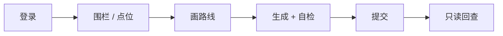

<p align="center">
  <picture>
    <source media="(prefers-color-scheme: dark)" srcset="assets/banner-dark.webp">
    
  </picture>
</p>

<p align="center">
  <a href="https://github.com/Knight-ask-art/KnightSportsWorldTool/releases/latest"></a>
  <a href="https://github.com/Knight-ask-art/KnightSportsWorldTool/releases"></a>
  
  
  
</p>

<p align="center">
  <picture>
    <source media="(prefers-color-scheme: dark)" srcset="assets/logo-light.png">
    
  </picture>
</p>

<h1 align="center">好想跑</h1>

<p align="center">
  <b>本地跑步数据工作台</b><br>
  登录自己的账号 → 拉取校区围栏与打卡点 → 画路线 / 造数 → 本地自检 → 提交 → 只读回查
</p>

<p align="center">
  <sub>本地生成 · 本地校验 · 数据留在本机 · 只登自己的账号</sub>
</p>

<p align="center">
  <a href="https://github.com/Knight-ask-art/KnightSportsWorldTool/releases/download/v0.1.8/haoxiangpao_v0.1.8_win64_setup.exe"></a>
  <a href="https://github.com/Knight-ask-art/KnightSportsWorldTool/releases/download/v0.1.8/haoxiangpao_v0.1.8_win64.zip"></a>
  <a href="https://github.com/Knight-ask-art/KnightSportsWorldTool/releases"></a>
</p>

<p align="center">
  <sub>安装版约 57 MB · 便携版约 80 MB · 只支持 Windows 10 / 11 64 位</sub>
</p>

> [!IMPORTANT]
> **完全免费，禁止倒卖。** 本项目没有付费版、付费安装、付费技术支持。若你是付费购买的，请立即申请退款并举报商家。
>
> **只登自己的号。** 仅用于本人账号与已授权环境，不要处理他人账号或未授权数据。

---

## 这是什么

一个给自己用的跑步数据工作台。

它在本地生成跑步轨迹，提交前先自检，提交后只读核对回执。账号状态、提交回执、点位缓存和设备信息都留在本机 `data/`，不经过第三方服务器。

| 项目 | 当前状态 |
|---|---|
| 版本 | **v0.1.8** · stable · 2026-11-04 |
| 回滚版本 | v0.1.7 |
| 系统 | Windows 10 / 11 · 64 位 |
| 兼容 | 运动世界校园（各校规则不同） |
| 网络 | 本机 `127.0.0.1` 工作台；提交直连官方接口 |
| 价格 | 完全免费 · 禁止倒卖 |

---

## 能做什么

<table>
<tr>
<td width="50%" valign="top">
<h3>🧭 校区与跑区</h3>
<p>按账号的校区信息自动匹配跑区，多账号各回各的校区。多跑区可以手动切换，下拉第一项「自动（按账号校区）」随时切回自动。选择按账号保存，下次登录还在。</p>
</td>
<td width="50%" valign="top">
<h3>🗺️ 路线工作台</h3>
<p>手绘加点、右键删点、拖动控制点、闭合绕圈；支持 GPX / GeoJSON / JSON / CSV 导入、200 / 300 / 400 m 田径场、高德道路吸附。撤销 / 重做是完整快照，<kbd>Ctrl</kbd> + <kbd>Z</kbd> 不会只撤回最后一个点。</p>
</td>
</tr>
<tr>
<td width="50%" valign="top">
<h3>🧪 提交前自检</h3>
<p>生成轨迹后先在本地检查距离、配速、时间窗、点位覆盖、围栏和校规；检查不过就不提交。把问题留在本地，而不是等服务器返回错误。</p>
</td>
<td width="50%" valign="top">
<h3>🛡️ 提交与只读核验</h3>
<p>提交结果卡会常驻在「提交」页。结果未知时按钮锁定，先去「记录」页只读核对回执。核验只读详情，<b>绝不重复提交、绝不补传轨迹</b>，空结果也不会被当成成功。</p>
</td>
</tr>
<tr>
<td width="50%" valign="top">
<h3>📈 记录、学期与计划</h3>
<p>本周 / 近 4 周、本学期进度、未来 14 天计划、最近记录和详情轨迹。支持回放、FIT / GPX / CSV 导出、提交回执、违规只读自查，以及最近 12 周跑量统计。</p>
</td>
<td width="50%" valign="top">
<h3>🔐 本地优先</h3>
<p>只监听 <code>127.0.0.1</code>；登录状态用 Windows 系统加密保存，密码默认不落盘，勾选「记住密码」才加密保存。不调用摄像头、不读取相册、不上传人脸；诊断包会自动脱敏。</p>
</td>
</tr>
</table>

---

## 界面

<p align="center">
  
</p>

<p align="center">
  <sub>v0.1.8 实拍：登录前免责声明确认、免费 / 防倒卖提示</sub>
</p>

---

## 从登录到回执



1. **登录**：手机号 + 密码；首次登录约 5–15 秒，不是卡死。
2. **拉围栏 / 点位**：按账号校区和跑区拉取；接口限流时按账号冷却，不跨账号。
3. **画路线**：手绘、导入、田径场或自动；目标距离默认 0，画完自动按线路填写。
4. **生成与自检**：生成轨迹后先做本地检查，再决定要不要提交。
5. **提交**：一次提交；超时视为未知状态，锁住时段，先核对再决定。
6. **回查**：查看状态、违规标记、轨迹和图表。

---

## 下载

### 安装版（推荐）

下载 `haoxiangpao_v0.1.8_win64_setup.exe`，双击安装。升级和卸载都**不会动 `data/`**。

### 便携版

下载 `haoxiangpao_v0.1.8_win64.zip`，解压后双击 `好想跑.exe`。

> [!WARNING]
> 便携版要整个文件夹一起用。`好想跑.exe` 旁边的依赖文件不要删，也别只把 exe 拖出来。

### GitHub 打不开？

在完整链接前面加镜像前缀（前两个实测可用，第三个时好时坏）：

| 前缀 | 状态 |
|---|---|
| `https://gh-proxy.com/` | 实测可用 |
| `https://ghfast.top/` | 实测可用 |
| `https://gh.llkk.cc/` | 时好时坏 |

例如安装版：

```text
https://gh-proxy.com/https://github.com/Knight-ask-art/KnightSportsWorldTool/releases/download/v0.1.8/haoxiangpao_v0.1.8_win64_setup.exe
```

---

## 第一次打开

1. 启动后先显示登录页；输入自己的手机号和密码。
2. 阅读并勾选「我同意并认真阅读了《免责声明》」，不勾选不能登录。
3. 登录成功后进入工作台，先走一遍 5 步新手引导；之后可以在「设置 → 关于 → 新手引导」重新打开。
4. `data/` 会自动出现，里面是登录状态、回执、限额、设备信息和点位缓存。想彻底重置就整个删掉，下次重新登录。

> [!NOTE]
> 从 v0.1.7 第一次升级到 v0.1.8 时，本机会退出一次登录，并要求重新确认《免责声明》。`data/` 不会删除，提交回执、限额和点位缓存都保留。

---

## 更新与回滚

程序启动后会自动检查更新。有新版时，左下角版本号旁边会出现下载图标：

- **安装版**：下载新的安装包，静默安装并重启。
- **便携版**：下载新 zip，自动解压替换并重启。

两种方式都不会覆盖 `data/`。下载后会校验文件完整性，只接受 HTTPS 资产。

| 场景 | 做法 |
|---|---|
| 手动升级 | 下载新安装包 / zip，覆盖旧目录，`data/` 留着别删 |
| 回滚到 v0.1.7 | 下载回滚包覆盖安装；登录状态兼容，不需要重新登录 |
| 完整性 | 安装包和 zip 都会校验；校验不过会自动换镜像 |
| 更新清单 | 程序自动读取，普通使用不用管 |

完整版本历史与发布说明：[Releases](https://github.com/Knight-ask-art/KnightSportsWorldTool/releases)。

---

## 三条边界

> [!CAUTION]
> 下面三条不是“建议”，是工具的工作方式。

| 边界 | 具体做法 |
|---|---|
| **不重试提交** | 网络超时 = 未知状态。提交前会记录并锁住该时段，宁可少跑一次，也不重复入库 |
| **本地闸门** | 默认每天最多 2 次，23:00–06:00 拒绝提交；高级用法可以在命令行调整 |
| **凭据只在本机** | 登录状态和密码都用 Windows 系统加密；密码默认不落盘；`data/` 不进安装包 |

### 适合 / 不适合

| ✅ 适合 | ⛔ 不适合 |
|---|---|
| 只登自己的账号 | 登别人的账号、批量代跑 |
| 自己的学校、自己的校区 | 绕过学校人脸抽检 |
| 想看清楚每次提交的数据 | 商业倒卖、付费安装、二次售卖 |
| 已授权环境下的学习 / 研究 | 未授权测试、破坏服务器 |

---

## 常见问题

<details>
<summary><b>提示 10121 怎么办？</b></summary>

账号还在手机端登录着。先去手机 App 退出，再回来登。
</details>

<details>
<summary><b>Windows 提示“未知发布者”</b></summary>

没有购买代码签名证书，正常现象。点「更多信息」→「仍要运行」。
</details>

<details>
<summary><b>双击后打不开 / 一闪就没</b></summary>

大概率是解压不完整，或者 exe 和旁边的 DLL / 文件夹分家了。重新解压一遍，确保整个文件夹完整。
</details>

<details>
<summary><b>点位提示冷却中</b></summary>

点位接口有频率限制。冷却按账号隔离，一个账号被限流不会锁住另一个账号；倒计时结束后点一次「刷新」。冷却期间会继续使用上次点位，并在界面上标注来源距离。
</details>

<details>
<summary><b>升级到 0.1.8 后要重新登录</b></summary>

v0.1.8 新增了登录前免责声明确认。第一次升级会退出旧会话一次，重新勾选后才能登录；`data/` 和回执都不会丢。
</details>

<details>
<summary><b>学校没有围栏 / 没有打卡点</b></summary>

没有围栏时，可以把地图拖到学校，点「设为校区」再刷新；没有打卡点时必须显式勾选「跳过打卡点（无点位学校，非官方自由跑）」。工具不会把空点位伪装成成功。
</details>

<details>
<summary><b>“自动”路线能不能用？</b></summary>

能用，但仍在打磨。优先手绘、导入 GPX 或田径场；自动跑出来的路线提交前也要自己看一眼。
</details>

<details>
<summary><b>会不会上传我的数据？</b></summary>

工作台只监听 `127.0.0.1`，不经过第三方服务器。提交时只向运动世界校园官方接口发送这次跑步需要的数据；不调用摄像头、不读取相册、不上传人脸。
</details>

---

## 关于

- 只支持 Windows 10 / 11 64 位；安装版和便携版都不会覆盖 `data/`。
- 只登自己的账号；不提供批量、代跑或人脸绕过。
- 发布页只放安装包、更新清单和这份说明。

> [!NOTE]
> 源码、内部研究资料和采集样本不随安装包分发。

---

## 说明

- **不需要上传人脸认证**：程序不调用摄像头、不读取相册，也不上传任何照片；登录和提交都不依赖人脸。
- 学校如果自己开了人脸抽查，那是学校和官方 App 之间的事，本工具不参与、也不代替；检测到人脸抽检会停止提交。
- 只要是运动世界校园的学校都能用；各校规则不同，学校要求可以在「设置 → 学校要求」里填，也能从服务器自动读取。
- 个人自用，不保证长期可用；学校接口一改，可能就失效了。
- 用不了可以提 [Issue](https://github.com/Knight-ask-art/KnightSportsWorldTool/issues)，我看到会看情况修。

---

## 免责声明

> 本软件仅供个人学习、技术研究及交流使用。请仅用于本人账号与已授权环境，不要处理他人账号或未授权数据。
>
> 软件按“现状”提供，不提供任何明示或暗示的担保；因使用不当、违规操作或恶意滥用产生的一切后果，由使用者自行承担。完整条款以软件内《软件使用协议与免责声明》为准。

<p align="center">
  <b>本项目完全免费。若您付费购买，请立即申请退款并举报商家。</b>
</p>

<p align="center">
  <a href="https://github.com/Knight-ask-art/KnightSportsWorldTool"></a>
</p>

<p align="center">
  <sub>如果它帮到了你，点个 Star 支持一下 ⭐</sub>
</p>
